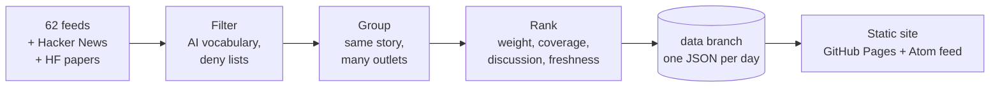

# AI Daily

A daily digest of AI, automation and integrations news for engineers. It reads ~64 sources every
morning, keeps what matters and ranks it with plain, readable rules. **No language model picks,
writes or summarises anything.**

> _AI Daily_ is a working title.



## Reading it

- **Desktop:** topics on the left, the day’s list in the middle, the story on a colored stage on the
  right. <kbd>J</kbd>/<kbd>K</kbd> to move, <kbd>O</kbd> to open, <kbd>F</kbd> for focus mode.
- **Phone:** the list is home. Tap a story to read it full screen, then swipe up for the next.
- **Feed reader:** subscribe to `/feed.xml`. One entry per day with the top stories.
- **JSON:** `/api/latest.json` and `/api/issues/YYYY-MM-DD.json`.

Every card says _why it’s here_: the rules that ranked it (coverage, points, matched terms). The
_How it works_ page lists every source and signal.

## Run it locally

Needs Node 24 (it runs TypeScript directly, there is no build step for the code).

```bash
npm install
npm run collect   # fetch today's issue into data/issues/
npm run dev       # preview on http://localhost:4321, rebuilds on save
```

`npm run dev` falls back to the fixtures in `test/fixtures/` until you have collected an issue.

| Script              | What it does                                    |
| ------------------- | ----------------------------------------------- |
| `npm run collect`   | Fetch, filter, group and rank. Writes one JSON. |
| `npm run build`     | Render every issue into `dist/`.                |
| `npm run dev`       | Build, serve and watch.                         |
| `npm run check`     | Typecheck, lint and test.                       |

## Publishing

Hosting is GitHub Pages, so there are no accounts, keys or secrets involved.

1. In **Settings → Pages**, set **Source** to **GitHub Actions**.
2. Run the **Publish** workflow once from the **Actions** tab (it also runs daily at 05:17 UTC and
   on every push to `main`).

The workflow collects the issue, commits it to the `data` branch (so `main` only holds code),
builds the site and deploys it.

> GitHub pauses scheduled workflows in repositories with no activity for 60 days. If the digest
> stops, re-enable **Publish** in the Actions tab.

## Changing what you get

- **Sources:** `src/sources.ts`. Each one has a weight (1–3), a section and optional filters.
- **Topics and their colors:** `src/topics.ts`.
- **Name, schedule-independent settings:** `src/config.ts`.
- **Ranking rules:** `src/collect/rank.ts`.

## Project layout

```
src/
  collect/   fetch → parse → filter → classify → cluster → rank → data/issues/<date>.json
  site/      static renderer: pages, Atom feed, CSS and a small script
  dev/       local preview server
test/        node:test suites and fixture issues
```

## License

[MIT](LICENSE)
