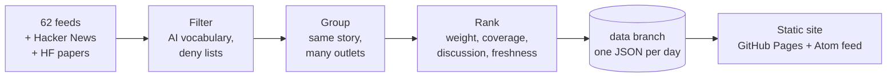

# Facet

A daily digest of AI, automation and integrations news for engineers. It reads ~64 sources every
morning, keeps what matters and ranks it with plain, readable rules. **No language model picks,
writes or summarises anything.**



## Reading it

- **Desktop:** topics on the left, the day’s list in the middle, the story on a colored stage on the
  right with what’s up next below. <kbd>J</kbd>/<kbd>K</kbd> to move, <kbd>O</kbd> to open,
  <kbd>S</kbd> to save, <kbd>F</kbd> for focus mode, <kbd>/</kbd> to search the page. _Hide read_
  keeps only what you haven’t seen (great on This week after time off); _Mark all read_ clears a view.
  Scroll over the story card to move between stories, or click the markers above it. Drag the
  dividers between columns to resize them (double-click resets); the widths are remembered in
  your browser.
- **Phone:** the list is home. Tap a story to read it full screen, then swipe up for the next.
  Add it to your home screen and it works offline.
- **This week:** `/week/` ranks every story of the last seven days, with the most mentioned terms
  and how they moved since the week before.
- **Make it yours:** pin or mute topics, set watch words (stories mentioning them are marked and
  collected under _Watching_), save stories for later (`/saved/`, exports to Markdown), and pick a
  light, dark or automatic theme. All of it stays in your browser.
- **Story links:** the address bar always points at the open story (`/2026/10/18/?s=…`), so
  copying it shares that exact story.
- **Feeds:** `/feed.xml` has one entry per day; `/feeds/top.xml` and `/feeds/<topic>.xml` have one
  entry per story, ready for a feed reader or an n8n, Zapier or Slack RSS trigger.
- **JSON:** `/api/latest.json` and `/api/issues/YYYY-MM-DD.json`.

Every card says _why it’s here_: the rules that ranked it (coverage, points, matched terms). The
_How it works_ page lists every source and signal, and flags sources that stopped answering.

## Run it locally

Needs Node 24 (it runs TypeScript directly, there is no build step for the code).

```bash
npm install
npm run collect   # fetch today's issue into data/issues/
npm run dev       # preview on http://localhost:4321, rebuilds on save
```

`npm run dev` falls back to the fixtures in `test/fixtures/` until you have collected an issue.

| Script              | What it does                                    |
| ------------------- | ----------------------------------------------- |
| `npm run collect`   | Fetch, filter, group and rank. Writes one JSON. |
| `npm run build`     | Render every issue into `dist/`.                |
| `npm run dev`       | Build, serve and watch.                         |
| `npm run check`     | Secrets check, typecheck, lint and test.        |

## Checks

CI runs two independent jobs on every push and pull request, so one failing never hides the other:

- **code:** typecheck, lint and format, tests, and a build of the site from fixtures. Every step
  runs and reports, even after an earlier one fails.
- **secrets:** `npm run secrets` fails on private keys, API tokens and absolute paths from a local
  machine in any tracked file.

Run the secrets check before every commit too, as a hook (once per clone):

```bash
git config core.hooksPath .githooks
```

Nothing the reader does (saved stories, read marks, pinned topics, watch words, theme) leaves the
browser.

## Publishing

Hosting is GitHub Pages, so there are no accounts, keys or secrets involved.

1. In **Settings → Pages**, set **Source** to **GitHub Actions**.
2. Run the **Publish** workflow once from the **Actions** tab (it also runs daily at 05:17 UTC and
   on every push to `main`).

The workflow collects the issue, commits it to the `data` branch (so `main` only holds code),
builds the site and deploys it.

> GitHub pauses scheduled workflows in repositories with no activity for 60 days. If the digest
> stops, re-enable **Publish** in the Actions tab.

## Repository settings

Everything below applies to this repository only.

1. **Settings → Pages:** set _Source_ to _GitHub Actions_.
2. **Settings → Actions → General:** keep _Workflow permissions_ on read-only; each workflow asks for
   the write access it needs.
3. **Settings → Advanced Security** (called _Code security_ on some accounts): turn on _Dependabot
   alerts_, _Dependabot security updates_, _Secret scanning_ with _Push protection_, and _Private
   vulnerability reporting_.
4. **Settings → General → Pull Requests:** allow squash merging only, and turn on _Automatically
   delete head branches_.
5. **Settings → Rules → Rulesets → New branch ruleset** for the default branch: _Restrict
   deletions_, _Block force pushes_, _Require a pull request before merging_ (0 approvals is fine
   when working alone) and _Require status checks to pass_ with the CI `code` and `secrets` jobs. The daily
   Publish run writes to the `data` branch, so the rules don't get in its way.

## Changing what you get

- **Sources:** `src/sources.ts`. Each one has a weight (1–3), a section and optional filters.
- **Topics and their colors:** `src/topics.ts`.
- **Name, schedule-independent settings:** `src/config.ts`.
- **Ranking rules:** `src/collect/rank.ts`.

## Project layout

```
src/
  collect/   fetch → parse → filter → classify → cluster → rank → data/issues/<date>.json
  site/      static renderer: pages, Atom feed, CSS and a small script
  dev/       local preview server
test/        node:test suites and fixture issues
```

## License

[MIT](LICENSE)
